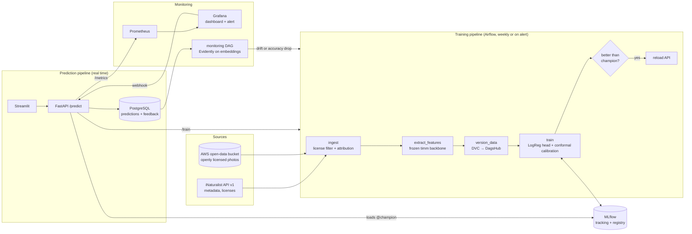

# Species identification from photographs: an MLOps pipeline

A service that identifies a species from a photograph and returns a confidence level. When the
model is not sure enough, it refers the observation to a human. Around it sits an automated
pipeline that ingests openly licensed iNaturalist photos, versions them, retrains, compares,
deploys and monitors the model.

> **Principle of the project:** the model is deliberately simple (a frozen pre-trained extractor
> plus a logistic regression); the work is in the production chain around it.

---

## Objectives and metrics

| Objective | Metric | Target |
|---|---|---|
| Answer most users without a human | review rate | ≤ 25% |
| Be right when answering alone | auto accuracy | ≥ 95% |
| Overall model quality | macro F1 on the test set | ≥ 0.85 (never promote below 0.60) |
| Honest uncertainty | conformal coverage | ≥ 90% (alpha = 0.10) |
| Fast enough for interactive use | p95 latency of /predict on CPU | ≤ 300 ms |
| Keep the model fresh without manual work | retraining | weekly, or on drift/alert |

---

## Architecture



| Service | Port | Role |
|---|---|---|
| `api` | 8000 | FastAPI: `/predict`, `/feedback`, `/train`, `/reload`, `/metrics`; documentation at `/docs` and `/redoc` |
| `streamlit` | 8501 | User interface: upload a photo, see the answer, correct it |
| `airflow` | 8080 | `species_training` (weekly) and `species_monitoring` (daily) DAGs |
| `mlflow` | 5000 | Experiment tracking and model registry (alias `champion`) |
| `postgres` | 5432 | Training metadata, predictions, feedback; MLflow and Airflow back ends |
| `prometheus` | 9090 | Scrapes API metrics |
| `grafana` | 3000 | Dashboard and the alert that triggers retraining |

---

## How it works

### 1. Data: open licenses and attribution
`src/data/ingest.py` queries the iNaturalist API for **research-grade** observations of the taxa
listed in `params.yaml`. It respects the 60 requests/minute limit and fetches only observations
newer than the last one stored, so every scheduled run adds new data.

A photo is kept only if **both** conditions hold:
- its license is in `allowed_licenses` (CC0, CC BY, CC BY-NC, CC BY-SA, CC BY-NC-SA; "no
  derivatives" licenses are excluded);
- it is hosted on `inaturalist-open-data.s3.amazonaws.com`. Photos on `static.inaturalist.org`
  are not openly licensed and are rejected even if the metadata looks right.

Observations identified to a subspecies are labelled with their species. The license code and the
attribution string are stored for every photo (in PostgreSQL and in `data/raw/metadata.csv`). Each
MLflow run also logs a `training_data_attribution.csv`, so a model can always be traced back to
the authors of its training images.

> The full open-data metadata dump on S3 is 36 GB, too large for the project VM. Calling the API
> for metadata is cheap: about 30 requests for 10 taxa.

### 2. Model: frozen extractor, simple head
- **Extractor:** `mobilenetv3_large_100` from `timm`, frozen. Embeddings are cached per photo and
  versioned with DVC, so a retraining run only embeds new images.
- **Head:** `StandardScaler` + `LogisticRegression(class_weight="balanced")`, saved as one sklearn
  pipeline. It trains in seconds on a CPU.
- **Split:** train / calibration / test, **stratified and stable**. Within each species, photos are
  ranked by observation id; every block of 20 consecutive photos gives 14 train, 3 calibration and
  3 test (70 / 15 / 15 %), from the very first run. Ingestion only appends newer observations, so a
  photo never changes part as the dataset grows: a new model and the champion are never evaluated
  on photos the champion was trained on.
- Species with fewer than `min_images_per_class` photos are left out of training, with a warning.

### 3. Confidence and human review: conformal prediction
Following Angelopoulos & Bates (2021), the calibration split gives a threshold `qhat` such that the
**prediction set** `{species : p ≥ 1 − qhat}` contains the true species at least 90% of the time
(`alpha = 0.10`). The API asks for human review when:
- the set holds more than one species (the model hesitates), or it is empty (nothing looks
  familiar, which often means the photo is outside the perimeter); or
- the top probability is below `min_confidence`.

The headline metric is therefore **`test_auto_accuracy`**: the accuracy of the answers the service
gives *without* a human, together with the **`test_review_rate`**, the share it hands over.

### 4. Versioning and promotion
- **Data:** `dvc add data/raw data/processed` (DVC without Git, as the course recommends), pushed
  to a DagsHub remote. The DVC hashes are stored as the `dataset_version` and `features_version`
  tags on every MLflow run.
- **Model:** each run is registered in the MLflow registry. The new version gets the `champion`
  alias only if it beats the current champion **on the same test set**, and it must also reach
  `min_macro_f1`. The decision and its reason are written as a tag on the version.
- **Deployment:** the API serves whatever version holds `champion`, and the DAG calls `/reload`
  after training. Rolling back means moving the alias in the MLflow UI and calling `/reload`.
- **Environment:** every Python package, including indirect dependencies, is pinned in `uv.lock`.
  The same lock builds the local environment, CI and all Docker images.

### 5. Monitoring and the feedback loop
- **Prometheus/Grafana:** request rate, p50/p95 latency, predictions per minute, review rate,
  mean confidence, accuracy on feedback, and the model version in production.
- **Alert:** if more than 50% of predictions over an hour need review, Grafana calls
  `POST /webhooks/grafana`, which triggers the training DAG.
- **Drift (Evidently, daily DAG):** this week's photo embeddings are compared with the training
  embeddings, after projecting both onto 10 PCA components. If drift is detected, or the accuracy
  on user corrections drops below 70%, the training DAG is triggered. The HTML report is logged in
  MLflow.
- **Feedback:** users correct a prediction in Streamlit (`POST /feedback`), and these labels feed
  the production-accuracy metric.

---

## Quick start

```bash
cp .env.example .env && echo "AIRFLOW_UID=$(id -u)" >> .env
```

```bash
make up
```

The core stack needs about 3.5 GB of RAM while training. On a 4 GB VM, add 4 GB of swap first (see
`docs/ROADMAP.md`). Prometheus and Grafana start separately, with `make up-monitoring`.

Unpause the DAGs, then trigger the first training:

```bash
docker compose exec airflow airflow dags unpause species_training
```

```bash
docker compose exec airflow airflow dags unpause species_monitoring
```

```bash
make train-dag
```

Follow the run in Airflow at http://localhost:8080 (login `admin` / `admin`). The first run
downloads about 1,500 photos (~90 MB) and trains in a few minutes on a CPU. When it finishes, open
http://localhost:8501.

### Local development environment (tests, lint, quick experiments)

Install [uv](https://docs.astral.sh/uv/) once (`curl -LsSf https://astral.sh/uv/install.sh | sh`),
then:

```bash
make venv
```

```bash
make lint test
```

`make venv` creates `.venv` from `uv.lock`, with Python 3.11 (the same version as CI and the Docker
images), downloading it if needed. Run `make lint test` before every commit: CI runs the same
checks. The same environment can run the pipeline outside Docker: `make ingest features train`,
then `make predict IMG=path/to/photo.jpg`.

**Adding or upgrading a dependency:** pick the group of the image that needs it (`api`,
`tracking`, `train`, `streamlit` or `dev`), then commit both `pyproject.toml` and `uv.lock`:

```bash
uv add --group train some-package==1.2.3
```

### Using DagsHub (optional, recommended)
1. Create a DagsHub repository, then set `MLFLOW_TRACKING_URI`, `MLFLOW_TRACKING_USERNAME` and
   `MLFLOW_TRACKING_PASSWORD` in `.env` (see `.env.example`).
2. Add the DVC remote once:

```bash
dvc remote add -d origin https://dagshub.com/<user>/<repo>.dvc
```

```bash
dvc remote modify origin --local auth basic
```

```bash
dvc remote modify origin --local user <user>
```

```bash
dvc remote modify origin --local password <token>
```

---

## Repository layout

```
├── params.yaml                 taxa, licenses, extractor, thresholds: everything tunable
├── pyproject.toml, uv.lock     dependencies, one group per Docker image, all versions locked
├── src/
│   ├── config.py               paths and environment variables
│   ├── db.py                   SQLAlchemy schema (observations, photos, predictions, feedback)
│   ├── data/ingest.py          iNaturalist ingestion, license filter, attribution
│   ├── features/extract.py     frozen timm extractor and embedding cache
│   ├── models/train.py         training.py: train, evaluate, log, register, promote, compare
│   ├── models/predict.py       predict.py: load the champion and identify a photo
│   ├── models/conformal.py     split conformal prediction
│   ├── monitoring/drift.py     Evidently drift and feedback accuracy
│   └── api/main.py             FastAPI service
├── airflow/dags/               species_training, species_monitoring
├── streamlit_app/app.py        user interface
├── scripts/                    traffic simulator, taxa statistics
├── docker/                     one Dockerfile per service
├── monitoring/                 Prometheus config, Grafana datasource, dashboard and alert
├── k8s/api.yaml                optional k3s deployment of the API with autoscaling
├── tests/                      unit tests (no network, no model weights needed)
├── docs/ROADMAP.md             plan, resource budgets, pending work, notes for the defense
└── .github/workflows/          ci.yaml (lint, test, build), release.yaml (push to Docker Hub)
```

---

## Scope against the subject's levels

| Level | Item | Status |
|---|---|---|
| 1 | ~10 taxa, frozen extractor, ingestion-to-deployment chain closed | ✅ |
| 1 | License filtering and attribution kept through the pipeline | ✅ |
| 2 | Same-protocol comparison of extractors, accuracy vs cost (`make compare`) | ✅ script, results to fill in |
| 2 | Service optimisation: CPU-only torch, baked weights, slim API image | ✅ partial |
| 2 | Versioning a growing dataset with DVC, hardlinked cache | ✅ |
| 3 | Feedback collection, production accuracy, prediction history | ✅ |
| 3 | Label revisions (past predictions when the ground truth changes) | 📝 design in `docs/ROADMAP.md` |
| 4 | Out-of-perimeter detection | ✅ partial (empty or ambiguous conformal set → review) |
| 4 | New taxon without manual work | ✅ add a name to `params.yaml`: ingestion, training and promotion handle it |

## Design choices

- **FastAPI rather than BentoML for serving.** The MLflow registry already handles model
  versioning, and one serving framework is easier to explain and debug in a week.
- **Logistic regression rather than fine-tuning.** It trains in seconds, is well calibrated enough
  for conformal prediction, and keeps the focus on the chain.
- **Embeddings as the drift signal.** Raw pixels are high-dimensional and noisy. PCA on the
  embeddings captures what the model actually "sees".
- **Airflow runs project code in its own virtualenv.** Airflow 2.10 pins SQLAlchemy 1.4, while
  the project uses 2.0; separate interpreters avoid the conflict.
- **uv with one dependency group per image.** Each image installs only what it needs (the
  Streamlit image has no torch), and all of them come from the same lock file.

## References

- Van Horn et al., *The iNaturalist Species Classification and Detection Dataset*, 2017.
- Cui et al., *Class-Balanced Loss Based on Effective Number of Samples*, 2019.
- Angelopoulos & Bates, *A Gentle Introduction to Conformal Prediction*, 2021.
- iNaturalist open data: https://github.com/inaturalist/inaturalist-open-data

Training photos © their respective iNaturalist authors, used under the Creative Commons license
recorded for each photo in `data/raw/metadata.csv`.
