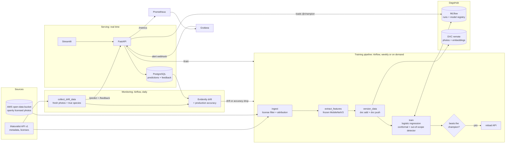
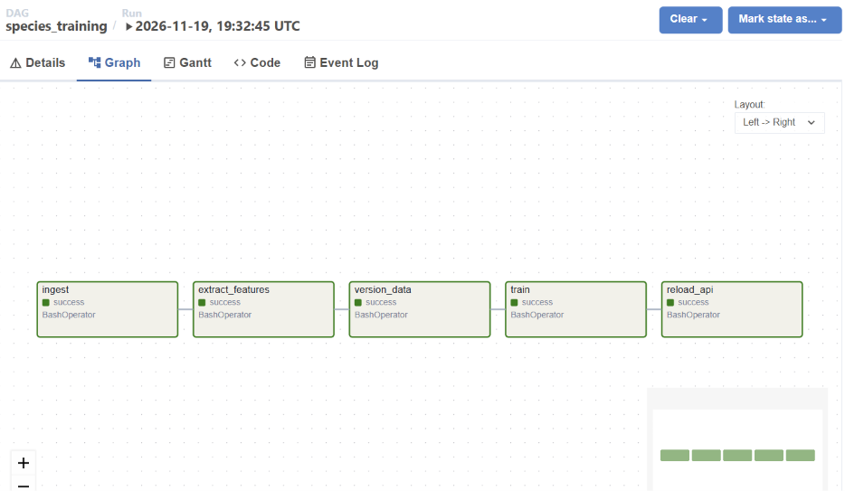
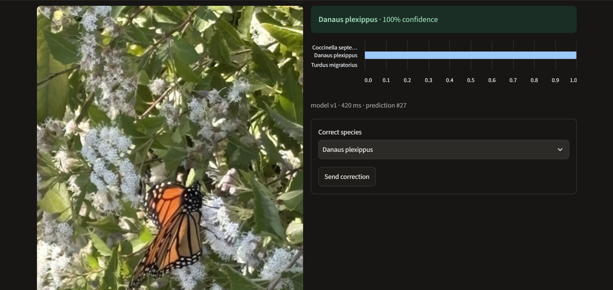
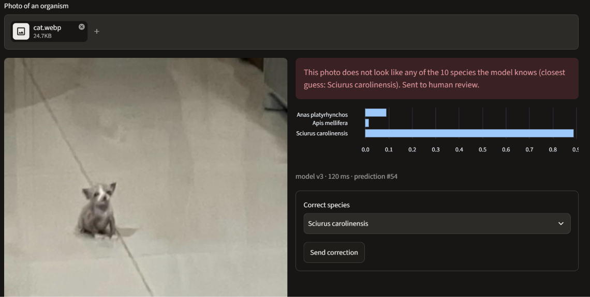
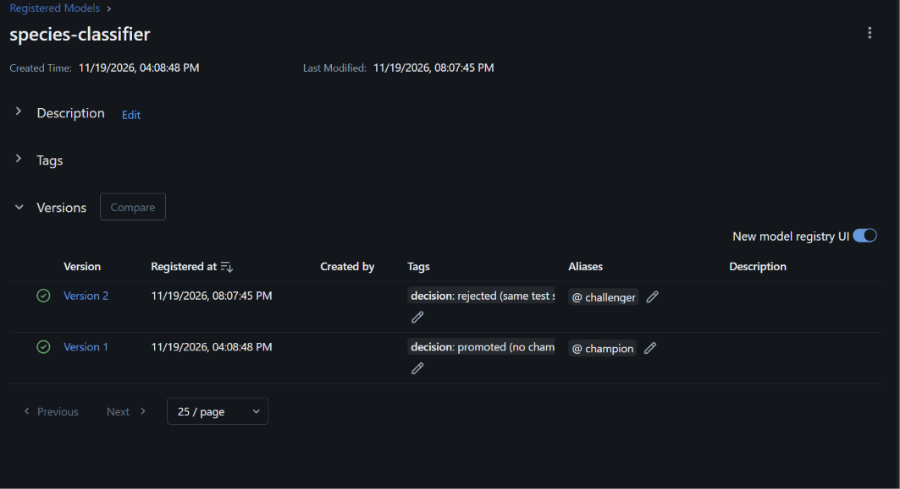
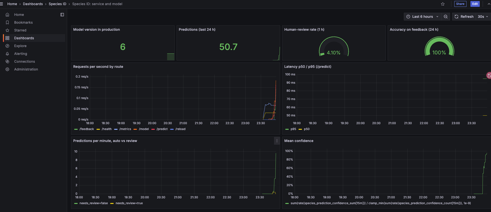
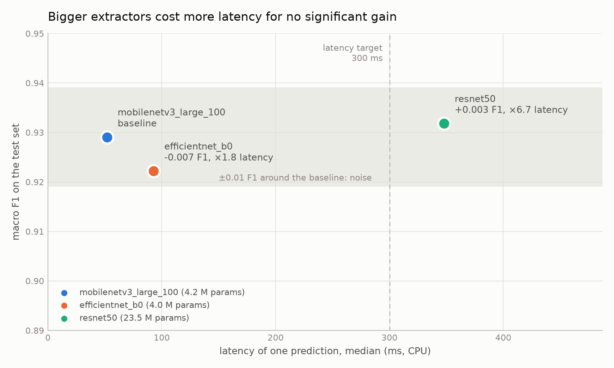

# Species identification from photographs: an MLOps pipeline

A service that identifies a species from a photograph and returns a calibrated confidence. When the
model is unsure, or when the photo does not look like anything it was trained on, it refers the
observation to a human. Around it runs an automated pipeline that ingests openly licensed
iNaturalist photos, versions them, retrains, compares, deploys and monitors the model.

> **Principle of the project:** the model is deliberately simple (a frozen pre-trained extractor
> plus a logistic regression); the work is in the production chain around it.

---

## Results at a glance

Champion model v3: ten species, 3,299 photos (about 330 each, ~500 in the test set), CPU only
(2 vCPUs, 3.8 GB RAM).

| Objective | Metric | Target | Measured |
|---|---|---|---|
| Answer most users without a human | review rate | ≤ 25% | **10.0%** ✅ |
| Be right when answering alone | auto accuracy | ≥ 95% | **96.0%** ✅ |
| Overall model quality | macro F1 (test set) | ≥ 0.85 | **0.914** ✅ |
| Honest uncertainty | conformal coverage | ≥ 90% (alpha = 0.10) | **86.8%** ≈ (±2 points of sampling noise on ~500 photos) |
| Few false alarms on normal photos | out-of-scope flag rate | ≈ 1% | **1.6%** ✅ |
| Fast enough for interactive use | p95 latency of one prediction (CPU) | ≤ 300 ms | **55 ms** ✅ |
| Keep the model fresh without manual work | retraining | weekly, or on drift / alert | ✅ automated |

---|---|---|---|
| Answer most users without a human | review rate | ≤ 25% | **5.6%** ✅ |
| Be right when answering alone | auto accuracy | ≥ 95% | **94.8%** ≈ |
| Overall model quality | macro F1 (test set) | ≥ 0.85 | **0.929** ✅ |
| Honest uncertainty | conformal coverage | ≥ 90% (alpha = 0.10) | **89.5%** ≈ (within sampling noise) |
| Fast enough for interactive use | p95 latency of one prediction (CPU) | ≤ 300 ms | **81 ms** ✅ |
| Keep the model fresh without manual work | retraining | weekly, or on drift / alert | ✅ automated |

---

## Architecture





| Service | Port | Role |
|---|---|---|
| `api` | 8000 | FastAPI: `/predict`, `/feedback`, `/model`, `/health`, `/metrics`; admin `/train`, `/reload`; docs at `/docs` |
| `streamlit` | 8501 | User interface: upload a photo, see the answer, correct it |
| `airflow` | 8080 | `species_training` (weekly) and `species_monitoring` (daily) DAGs |
| `postgres` | 5432 | Training metadata, predictions, feedback; Airflow back end |
| `prometheus`, `grafana` | 9090, 3000 | Service metrics, dashboard, and the alert that triggers retraining (`make up-monitoring`) |
| DagsHub | (hosted) | MLflow tracking and model registry; DVC remote storage |
| `mlflow` | 5000 | Offline fallback only, started by hand (`make mlflow-local`) |

---

## How it works

### 1. Data: open licenses and attribution
`src/data/ingest.py` queries the iNaturalist API for **research-grade** observations of the ten
species listed in `params.yaml`. It respects the 60 requests/minute limit and only fetches
observations newer than the last one stored, so every scheduled run adds 30 new photos per species
(up to 400).

A photo is kept only if **both** conditions hold:
- its license is in `allowed_licenses` (CC0, CC BY, CC BY-NC, CC BY-SA, CC BY-NC-SA); "no
  derivatives" licenses are excluded;
- it is hosted on the AWS open-data bucket. Photos on `static.inaturalist.org` are not openly
  licensed and are rejected.

Observations identified to a subspecies are labelled with their species. The license and the
author's attribution are stored for every photo (PostgreSQL and `data/raw/metadata.csv`), and each
MLflow run logs a `training_data_attribution.csv`.

**Why these ten species:** common, from several kingdoms (insects, birds, a mammal, plants, a
fungus), and very well represented: each has more than 118,000 openly licensed photos, while the
pipeline uses at most 400 ([`reports/taxa_stats.md`](reports/taxa_stats.md)).

| species | research-grade observations | openly licensed photos |
|---|---|---|
| *Danaus plexippus* | 544,952 | 406,266 |
| *Apis mellifera* | 745,382 | 565,603 |
| *Coccinella septempunctata* | 305,140 | 240,213 |
| *Cardinalis cardinalis* | 356,529 | 271,490 |
| *Turdus migratorius* | 428,811 | 331,049 |
| *Anas platyrhynchos* | 924,921 | 728,518 |
| *Sciurus carolinensis* | 402,536 | 315,522 |
| *Taraxacum officinale* | 167,292 | 129,963 |
| *Achillea millefolium* | 276,582 | 212,239 |
| *Amanita muscaria* | 161,631 | 118,491 |

### 2. Model: frozen extractor, simple head
- **Extractor:** `mobilenetv3_large_100` from `timm`, frozen; 1,280-value embedding per photo.
  Embeddings are cached and versioned, so a retraining run only embeds new photos.
- **Head:** `StandardScaler` + `LogisticRegression(class_weight="balanced")`, saved as one sklearn
  pipeline. It trains in seconds on a CPU.
- **Split: stratified and stable.** Within each species, photos are ranked by observation id; every
  block of 20 gives 14 train, 3 calibration and 3 test photos. Ingestion only appends newer
  observations, so a photo never changes part: a new model and the champion are never evaluated on
  photos the champion was trained on.

### 3. When to ask a human
The API sends a photo to human review in two situations.

**The model hesitates: conformal prediction.** Following Angelopoulos & Bates (2021), the
calibration split gives a threshold `qhat` such that the **prediction set**
`{species : p ≥ 1 − qhat}` contains the true species at least 90% of the time. If the set holds
more than one species, or the top probability is below `min_confidence`, the photo goes to review.

**The photo is outside the perimeter: out-of-scope detection.** A classifier always answers with
one of its known species, even for a cat, and conformal guarantees only hold for photos like the
training data. So the model also measures the distance from the photo to its 5 nearest training
photos (Sun et al., 2022). The threshold is calibrated so that about 1% of normal photos are
flagged; a photo unlike any training photo is flagged and sent to review.

| Photo | Result |
|---|---|
| Monarch butterfly |  |
| Cat |  |

### 4. Versioning, comparison and promotion
- **Data:** the pipeline runs `dvc add data/raw data/processed` (DVC without Git, as the course
  recommends) and pushes to the DagsHub DVC remote, which keeps every version. Each MLflow run
  stores the DVC hashes as tags (`dataset_version`, `features_version`) **and the two `.dvc` files
  as artifacts** (`data_version/`): `dvc pull` with them restores the exact data of any model.
- **Experiments:** every run logs its parameters, metrics (global and per species), a confusion
  matrix, the classification report and the attribution file to the DagsHub MLflow.
- **Registry:** every pipeline run registers a new version of `species-classifier`. The new
  version gets the **`champion`** alias only if it scores at least as well as the current champion
  **on the same test set**, and at least `min_macro_f1`. A rejected version gets the
  **`challenger`** alias. Every decision and its reason are stored as a `decision` tag, including
  manual promotions.
- **Deployment:** the API always serves `models:/species-classifier@champion` and reloads it after
  training. Rolling back = moving the alias and calling `/reload`.
- **Environment:** every Python package, including indirect dependencies, is pinned in `uv.lock`;
  the same lock builds the local environment, CI and all Docker images.



### 5. Monitoring and the feedback loop
- **Production traffic without users:** every night, `collect_drift_data` sends 2 freshly
  uploaded, openly licensed iNaturalist photos per species to `/predict`, then their
  community-validated species to `/feedback`. Training photos are never reused.
- **Drift (Evidently):** the last 7 days of photo embeddings are compared with the training
  embeddings, on 10 PCA components. The HTML report is logged to MLflow.
- **Accuracy in production:** computed from feedback (the collector's labels and user
  corrections in Streamlit).
- **Retraining triggers:** drift, accuracy below 70%, or the Grafana alert (more than 50% of
  predictions sent to review over an hour) start the training pipeline.
- **Grafana:** request rate, latency, predictions per minute, review rate, mean confidence,
  accuracy on feedback, model version in production.



### 6. Extractor comparison: accuracy vs cost
Same photos, split, head and metrics for three extractors (`make compare`):

| extractor | macro F1 | F1 gain vs baseline | auto accuracy | review rate | coverage | latency p50 (ms) | latency p95 (ms) | latency vs baseline | params (M) | weights (MB) |
|---|---|---|---|---|---|---|---|---|---|---|
| `mobilenetv3_large_100` | 0.929 | +0.000 | 94.8% | 5.6% | 89.5% | 52 | 81 | ×1.0 | 4.2 | 16 |
| `efficientnet_b0` | 0.922 | -0.007 | 95.8% | 7.1% | 89.0% | 93 | 108 | ×1.8 | 4.0 | 15 |
| `resnet50` | 0.932 | +0.003 | 95.8% | 6.8% | 89.3% | 348 | 390 | ×6.7 | 23.5 | 90 |

**Decision: keep MobileNetV3.** ResNet-50 gains +0.003 F1, which is within noise on ~400 test
photos, for 6.7× the latency, beyond the 300 ms target. EfficientNet-B0 is 1.8× slower for no gain.
All three reach about 0.93: the extractor is not the bottleneck.



### 7. Reliability
- Every service restarts by itself after a reboot; the API keeps retrying until the model is
  reachable.
- Uploads to the DVC remote are retried on transient errors; every Airflow task has a retry.
- The API image bakes in the extractor weights: no download at start-up.

---

## Quick start

```bash
cp .env.example .env && echo "AIRFLOW_UID=$(id -u)" >> .env
```

Add your DagsHub repository and token to `.env` (see `.env.example`):

```
MLFLOW_TRACKING_URI=https://dagshub.com/<user>/<repo>.mlflow
MLFLOW_TRACKING_USERNAME=<user>
MLFLOW_TRACKING_PASSWORD=<token>
```

Configure the DVC remote once (credentials go to `.dvc/config.local`, which Git ignores):

```bash
uv run dvc remote add -d origin https://dagshub.com/<user>/<repo>.dvc
```

```bash
uv run dvc remote modify origin --local auth basic
```

```bash
uv run dvc remote modify origin --local user <user>
```

```bash
uv run dvc remote modify origin --local password <token>
```

Build and start the stack, then trigger the first training:

```bash
make up
```

```bash
docker compose exec airflow airflow dags unpause species_training && docker compose exec airflow airflow dags unpause species_monitoring
```

```bash
make train-dag
```

Follow the run in Airflow (http://localhost:8080). When it finishes, open Streamlit
(http://localhost:8501). Grafana and Prometheus: `make up-monitoring`.

> On a 4 GB VM, add 4 GB of swap and stop k3s first (see `docs/ROADMAP.md`). With several
> machines on one DagsHub repository, only one should run `species_training`: they share a single
> model registry.

### Local development environment

Install [uv](https://docs.astral.sh/uv/) once (`curl -LsSf https://astral.sh/uv/install.sh | sh`),
then:

```bash
make venv
```

```bash
make lint test
```

`make venv` creates `.venv` from `uv.lock`, with Python 3.11 (the same as CI and the images). Run
`make lint test` before every commit: CI runs the same checks.

**Adding a dependency:** pick the group of the image that needs it (`api`, `tracking`, `train`,
`streamlit` or `dev`), then commit both `pyproject.toml` and `uv.lock`:

```bash
uv add --group train some-package==1.2.3
```

### Useful commands

| Command | What it does |
|---|---|
| `make train-dag` | trigger the training pipeline |
| `make compare` | run the extractor comparison in the background (`tail -f reports/compare.log`) |
| `make taxa-stats` | refresh the species statistics |
| `make up-monitoring` | start Prometheus and Grafana |
| `make mlflow-local` | start the offline MLflow fallback |
| `make clean-docker` | reclaim disk after image builds |
| `make help` | list everything |

---

## Repository layout

```
├── params.yaml                 species, licenses, extractor, thresholds: everything tunable
├── pyproject.toml, uv.lock     dependencies, one group per Docker image, all versions locked
├── src/
│   ├── config.py               paths and environment variables
│   ├── db.py                   SQLAlchemy schema (observations, photos, predictions, feedback)
│   ├── data/ingest.py          iNaturalist ingestion, license filter, attribution
│   ├── data/ingest_drift.py    daily monitoring traffic: fresh photos + true species
│   ├── features/extract.py     frozen timm extractor and embedding cache
│   ├── models/train.py         training.py: train, evaluate, log, register, promote, compare
│   ├── models/predict.py       predict.py: load the champion and identify a photo
│   ├── models/conformal.py     split conformal prediction
│   ├── models/ood.py           out-of-scope detection (k-nearest-neighbour distance)
│   ├── monitoring/drift.py     Evidently drift and production accuracy
│   └── api/main.py             FastAPI service
├── airflow/dags/               species_training, species_monitoring
├── streamlit_app/app.py        user interface
├── scripts/taxa_stats.py       iNaturalist counts per species
├── reports/                    extractor comparison, species statistics
├── docker/                     one Dockerfile per service
├── monitoring/                 Prometheus config, Grafana datasource, dashboard and alert
├── k8s/api.yaml                optional k3s deployment of the API with autoscaling
├── tests/                      unit tests (no network, no model weights needed)
├── docs/ROADMAP.md             plan, resource budgets, pending work, notes for the defense
└── .github/workflows/          ci.yaml (lint, test, build), release.yaml (push to Docker Hub)
```

---

## Scope against the subject's levels

| Level | Item | Status |
|---|---|---|
| 1 | ~10 taxa, frozen extractor, ingestion-to-deployment chain closed | ✅ |
| 1 | License filtering and attribution kept through the pipeline | ✅ |
| 2 | Same-protocol comparison of extractors, gain vs service cost | ✅ MobileNetV3 kept |
| 2 | Service optimisation: CPU-only torch, baked weights, one dependency group per image | ✅ |
| 2 | Versioning a growing dataset, sustainable storage | ✅ DVC + DagsHub, hardlinked cache |
| 3 | Automatic collection of validated identifications, production accuracy, history | ✅ daily collector |
| 3 | Label revisions | 📝 design in `docs/ROADMAP.md` |
| 4 | Detection of photos outside the perimeter | ✅ k-nearest-neighbour detector |
| 4 | New taxon without manual intervention | ✅ add a name to `params.yaml` |
| 4 | Active selection of photos for review | 📝 design in `docs/ROADMAP.md` |

## Design choices and known limitations

- **FastAPI rather than BentoML:** the MLflow registry already versions models; one serving
  framework is easier to explain and debug.
- **Logistic regression rather than fine-tuning:** trains in seconds, well suited to conformal
  calibration, keeps the focus on the chain.
- **Airflow runs project code in its own virtualenv:** Airflow 2.10 pins SQLAlchemy 1.4, the
  project uses 2.0.
- **Airflow is the pipeline orchestrator,** so there is no `dvc.yaml`: the Airflow graph is the
  pipeline diagram.
- **Look-alike species** (e.g. the viceroy butterfly, which mimics the monarch) are predicted as
  the species they imitate. Only adding them to the perimeter solves that.
- **Feedback measures accuracy in production but is not yet added to the training data.**
- **Security is course-grade:** default passwords and basic auth. A real deployment needs the
  checklist in `docs/ROADMAP.md`.

## References

- Van Horn et al., *The iNaturalist Species Classification and Detection Dataset*, 2017.
- Cui et al., *Class-Balanced Loss Based on Effective Number of Samples*, 2019.
- Angelopoulos & Bates, *A Gentle Introduction to Conformal Prediction*, 2021.
- Sun et al., *Out-of-Distribution Detection with Deep Nearest Neighbors*, 2022.
- iNaturalist open data: https://github.com/inaturalist/inaturalist-open-data

Training photos © their respective iNaturalist authors, used under the Creative Commons license
recorded for each photo in `data/raw/metadata.csv`.
